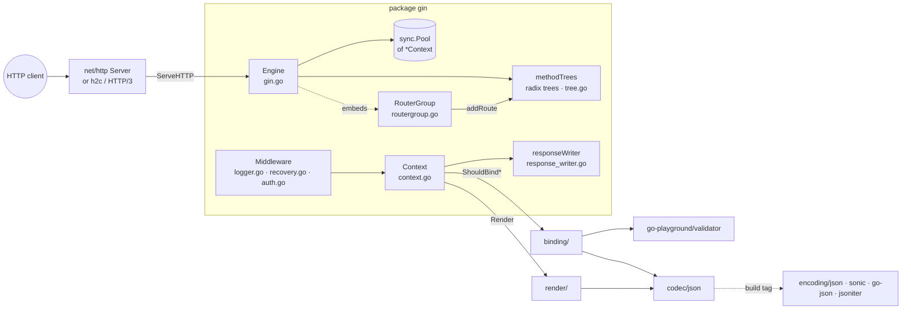

# Code Analysis: Gin (github.com/gin-gonic/gin)

*Analysed version: `v1.12.0` (`gin/version.go`), module targets Go 1.26 (`gin/go.mod`). All paths below are relative to `gin/`.*

> **Method note:** The Go toolchain is not installed on the analysis machine, so `go list ./...`, `go mod graph` and `go doc` could not be run. Package and dependency maps were built by reading `go.mod` and grepping `package` and `import` statements instead. Test and line counts come from `grep`/`wc`.

---

## 1. Summary

Gin is an HTTP web framework that sits as a thin, very fast layer on top of Go's standard library `net/http`. Its core is a single `Engine` (which *is* an `http.Handler`). The engine finds the right handler list using a radix tree it inherited from julienschmidt/httprouter, and then runs that list as a middleware chain over a pooled, reusable `*Context` object. Input parsing ("binding") and output writing ("rendering") are pluggable strategies behind two small interfaces, `binding.Binding` and `render.Render`. The codebase is compact (≈8,300 lines of non-test Go) and heavily tested (≈16,200 lines of tests, 644 test functions, 28 benchmarks). Its architecture favours performance over purity: object pooling, zero-allocation `unsafe` string conversions, and a flat root package where `Context` alone is 1,543 lines. The main trade-offs are a large, stable-forever public API, some global state (mode, validator, JSON codec), and a fairly heavy dependency tree for a "minimal" framework.

---

## 2. (A) What the project does and for whom

**Problem:** Go's `net/http` gives you a server and a basic router, but very little help with path parameters, middleware composition, request validation, or content negotiation. Gin adds exactly those things while keeping request overhead close to zero.

**Target users:** Backend developers who build REST/JSON APIs, microservices and server-rendered web apps in Go. The README describes it as "a Martini-like API but with significantly better performance—up to 40 times faster—thanks to httprouter" (`README.md:20`). It is meant to feel familiar to people coming from Express.js (`README.md:24`).

**Positioning:**

| Framework | Relationship to `net/http` | Router | Notes |
|---|---|---|---|
| `net/http` `ServeMux` (Go 1.22+) | *is* the stdlib | pattern mux with methods and wildcards | No middleware chain, no binding or validation |
| **Gin** | Builds on it, `Engine` implements `http.Handler` | Radix tree (httprouter fork) | Pooled `Context`, binding, validation and rendering built in |
| Echo | Builds on it | Radix tree | Very similar feature set; handlers return `error` |
| Chi | Builds on it, uses stdlib handler signatures | Radix tree | Minimal, fully `net/http`-compatible |
| Fiber | Replaces it with `fasthttp` | Custom | Faster in microbenchmarks, but not `net/http`-compatible |

Gin's niche is "batteries included, but still `net/http`". Since Go 1.22's `ServeMux` gained method and wildcard routing, the routing part matters less as a differentiator. The handler/middleware/binding ergonomics are now the main reason people choose Gin.

---

## 3. (B) Architecture overview

### 3.1 Package map

> **Go primer:** a *package* is one directory of `.go` files that share a namespace. A *module* (`go.mod`) is a versioned collection of packages. Identifiers that start with a capital letter are exported (public). Lowercase identifiers are package-private.

| Package (directory) | Responsibility | Key types / functions |
|---|---|---|
| `gin` (root, 18 non-test files) | Engine, routing, context, middleware, errors, modes | `Engine`, `RouterGroup`, `Context`, `HandlerFunc`, `HandlersChain`, `ResponseWriter`, `Error`, `Logger()`, `Recovery()`, `BasicAuth()` |
| `binding/` | Parse requests (JSON, XML, form, query, URI, header, YAML, TOML, protobuf, msgpack, BSON) into structs, then validate them | `Binding`, `BindingBody`, `BindingUri`, `StructValidator`, `Default()` |
| `render/` | Write responses in many formats | `Render`, `JSON`, `HTML`, `XML`, `YAML`, `ProtoBuf`, `Redirect`, `Reader`, `PDF` … |
| `codec/json/` | Swap the JSON library at compile time | `Core`, `API`, one implementation per build tag |
| `internal/bytesconv` | Zero-copy `string`↔`[]byte` | `StringToBytes`, `BytesToString` |
| `internal/fs` | Filesystem wrapper that hides directory listings for static files | |
| `ginS/` | "Singleton" API (`ginS.GET(...)`) backed by a lazily created global engine | `sync.OnceValue(gin.Default)` (`ginS/gins.go:15`) |
| `testdata/` | Certificates, templates, a protobuf example used by tests | |

The `internal/` directory is a Go language rule, not just a convention: packages under `internal/` can only be imported by code inside the same module. This is the boundary that go.dev's *Organizing a Go module* recommends.

### 3.2 C4 component view



### 3.3 Request lifecycle (runtime view)

```mermaid
sequenceDiagram
    participant S as http.Server
    participant E as Engine
    participant P as sync.Pool
    participant T as radix tree
    participant C as Context
    participant H as handlers[0..n]

    S->>E: ServeHTTP(w, req)            
    E->>E: routeTreesUpdated.Do(updateRouteTrees)
    E->>P: Get() *Context
    E->>C: writermem.reset(w); reset()
    E->>T: getValue(path, params, skippedNodes)
    T-->>E: handlers, params, fullPath (or tsr hint)
    E->>C: c.Next()
    loop index < len(handlers)
        C->>H: handlers[index](c)
        H-->>C: may call c.Next() / c.Abort()
    end
    E->>C: writermem.WriteHeaderNow()
    E->>P: Put(c)
```

Step by step, with references:

1. **Start-up.** `Engine.Run` (`gin.go:566`) builds an `http.Server` with `Handler: engine.Handler()` and a default 10-second `ReadHeaderTimeout` against slowloris attacks (`gin.go:37`). It then calls `server.ListenAndServe()` (`gin.go:581`). `Handler()` wraps the engine in `h2c` if `UseH2C` is set (`gin.go:257`).
2. **Entry point.** `Engine.ServeHTTP` (`gin.go:691`) is the method that makes `Engine` satisfy Go's `http.Handler` interface. It takes a `*Context` from `engine.pool` (`gin.go:696`), resets it, dispatches the request, and puts the context back (`gin.go:703`).
3. **Routing.** `handleHTTPRequest` (`gin.go:719`) does a *linear scan* over `engine.trees` to find the tree for the HTTP method. It then calls `root.getValue(...)` (`tree.go:418`), which walks the radix tree and fills the pre-allocated `Params` slice. If nothing matches, it tries a trailing-slash redirect, then fixed-path correction, then 405 (with an RFC 7231 `Allow` header), and finally 404 via `serveError` (`gin.go:793`).
4. **Handler chain.** `c.Next()` (`context.go:197`) increments `c.index` and runs the handlers in order. Middleware calls `c.Next()` *inside* itself to run "the rest of the chain" and then continues afterwards. This is how `Logger` measures latency (`logger.go:282`) and how `Recovery` installs a `defer`/`recover` around everything after it (`recovery.go:59-90`). `c.Abort()` (`context.go:216`) sets `index = abortIndex` (`math.MaxInt8 >> 1` = 63, `context.go:57`), which ends the loop.
5. **Binding.** `c.ShouldBindWith(obj, b)` is just `b.Bind(c.Request, obj)` (`context.go:941`). `binding.Default(method, contentType)` (`binding/binding.go:95`) picks a strategy from the `Content-Type` header. After decoding, each binding calls `validate(obj)`, which delegates to the global `binding.Validator`.
6. **Rendering.** `c.JSON(code, obj)` builds a `render.JSON` and calls `c.Render` (`context.go:1201`). That sets the status, skips the body for 1xx/204/304 (`bodyAllowedForStatus`, `context.go:1109`), and calls `r.Render(c.Writer)`. Render errors are pushed onto `c.Errors`.
7. **Flush.** `responseWriter` (`response_writer.go:49`) defers `WriteHeader` until the first `Write` or until `WriteHeaderNow()`. This lets middleware change the status after the handler has run, as long as no body bytes have been sent.

### 3.4 Core abstractions and how they connect

- **`HandlerFunc func(*Context)`** (`gin.go:58`) and **`HandlersChain []HandlerFunc`** (`gin.go:64`). Every handler and every middleware has the same type. A route is simply a slice of them.
- **`RouterGroup`** (`routergroup.go:76`) holds a `basePath` and a set of `Handlers`. Registering a route calls `combineHandlers` (`routergroup.go:281`), which *copies* the group's middleware and the route's handlers into one flat slice. Middleware is therefore resolved at registration time, not per request.
- **`Engine`** (`gin.go:99`) *embeds* `RouterGroup`, which is Go's version of composition-over-inheritance. That is why `r.GET(...)` works directly on the engine. It also owns the trees, the context pool, the HTML templates and the trusted-proxy configuration.
- **`Context`** (`context.go:61`) is a per-request object holding the request, the response writer, path params, the handler slice with its cursor (`index`), a `Keys` map guarded by an `RWMutex`, and `Errors`. It also implements Go's standard `context.Context` interface (`Deadline/Done/Err/Value`, `context.go:1501-1527`), so it can be passed to database drivers and similar code.
- **`binding.Binding`** (`binding/binding.go:32`) and **`render.Render`** (`render/render.go:10`) are small interfaces with one implementation per format. This is the strategy pattern, and it follows the Go proverb "the bigger the interface, the weaker the abstraction."

### 3.5 Cross-cutting concerns

| Concern | How Gin handles it |
|---|---|
| **Errors** | `c.Error(err)` appends to `c.Errors` (`errors.go:38`). Errors carry a bit-flag `ErrorType` (`ErrorTypeBind = 1<<63`, `ErrorTypePublic`, …, `errors.go:18-28`), so middleware can filter them with `ByType`. Handlers do *not* return errors, which is a key difference from Echo. |
| **Panics** | `Recovery()` uses `defer` + `recover()`. It treats broken pipes (`EPIPE`, `ECONNRESET`, `http.ErrAbortHandler`) as non-fatal (`recovery.go:66-68`) and masks the `Authorization` header in dumps (`secureRequestDump`, `recovery.go:98`). |
| **Logging** | `Logger()` writes to `DefaultWriter` and only uses colour output when `go-isatty` detects a terminal (`logger.go:261`). |
| **Modes** | Debug, release and test mode are stored in a package-level `atomic` variable that is initialised from the `GIN_MODE` environment variable in `init()` (`mode.go:48-54`). Debug mode prints every registered route. |
| **Concurrency** | Each request runs in its own goroutine, which `net/http` creates. The `Context` is *recycled* after the request, so a handler that starts a goroutine must call `c.Copy()` first (`context.go:120-122`). `Keys` is mutex-protected. Route trees are built before serving and are read-only afterwards. |
| **Security** | Constant-time password comparison in `BasicAuth` (`auth.go:37`), a default `ReadHeaderTimeout`, a trusted-proxy CIDR list for `ClientIP()`, and a warning when all proxies are trusted (`gin.go:570`). |

---

## 4. (C) The three most important technical dependencies

The most important dependency is not in `go.mod` at all: it is the standard library's **`net/http`**. Gin never replaces it. It only implements `http.Handler`. Among the external modules in `go.mod`, ranked by architectural importance:

**1. `github.com/go-playground/validator/v10`, the validation engine.**
*Where:* only `binding/default_validator.go:13`, where it is lazily created (`validator.New()`, line 95).
*Why:* the `binding:"required,email"` *struct tags* on request structs are interpreted by this library. (A struct tag is a string annotation on a struct field that libraries read at runtime through reflection.) Every `ShouldBind*`/`Bind*` call goes through it.
*Without it:* binding would still decode data, but nothing would validate it. Gin has abstracted it well: it hides behind the one-method `StructValidator` interface (`binding/binding.go:55`), and users can replace `binding.Validator` with their own implementation.

**2. `golang.org/x/net` (`http2`, `http2/h2c`), the HTTP/2 transport extensions.**
*Where:* `gin.go:22-23`, used in `Engine.Handler()`.
*Why:* stdlib HTTP/2 normally requires TLS. `h2c` allows HTTP/2 over plain TCP, which is common behind load balancers and for gRPC-style traffic. `x/net` is the Go team's "semi-standard library", so it is a low-risk dependency.
*Without it:* the `UseH2C` option would disappear. Normal HTTP/1.1 and TLS HTTP/2 would still work through the stdlib.

**3. `github.com/quic-go/quic-go`, HTTP/3 over QUIC.**
*Where:* `gin.go:21`, used only in `Engine.RunQUIC` (`gin.go:658`).
*Why:* it gives Gin a one-line HTTP/3 server.
*Cost:* this is the heaviest transport dependency (it pulls in `qpack`, `x/crypto` and `go.uber.org/mock`), and every Gin user downloads it even if they never call `RunQUIC`. It is a good example of "convenience API vs. dependency weight."

**Honourable mentions (format plugins):** `ugorji/go/codec` (msgpack), `goccy/go-yaml`, `pelletier/go-toml/v2`, `google.golang.org/protobuf`, `mongo-driver/v2/bson` (used by `binding/` and `render/`), `gin-contrib/sse` (`c.SSEvent`, `context.go:1373`), and `mattn/go-isatty` (log colours).

**Optional through build tags:** a *build tag* (`//go:build ...` at the top of a file) includes or excludes that file at compile time.

| Build tag | Effect | Files |
|---|---|---|
| `nomsgpack` | Drops msgpack binding and rendering (and the `ugorji` dependency from the binary) | `binding/binding_nomsgpack.go`, `binding/msgpack.go`, `render/msgpack.go` |
| `sonic` (linux/windows/darwin) | JSON via ByteDance's JIT-based `sonic` | `codec/json/sonic.go` |
| `go_json` | JSON via `goccy/go-json` | `codec/json/go_json.go` |
| `jsoniter` | JSON via `json-iterator/go` | `codec/json/jsoniter.go` |
| *(none)* | Default: stdlib `encoding/json` | `codec/json/json.go` (`//go:build !jsoniter && !go_json && !(sonic && …)`) |
| `appengine` | Sets the trusted platform to Google App Engine | `context_appengine.go` |

YAML, TOML, protobuf and BSON have **no** opt-out tag, so they are always compiled in.

---

## 5. Common Go conventions in the codebase

| Convention | Example in Gin | Why it is idiomatic |
|---|---|---|
| Implement stdlib interfaces | `Engine.ServeHTTP` (`gin.go:691`); `Context` implements `context.Context` | "Accept interfaces": Gin works with any `http.Server`, test recorder or proxy |
| Compile-time interface assertions | `var _ Render = (*JSON)(nil)` (`render/render.go:17-35`); `var _ IRouter = (*RouterGroup)(nil)` (`routergroup.go:84`) | The build fails if a type stops satisfying the interface (*Effective Go*, "Interface checks") |
| Small interfaces | `Binding` (2 methods), `Render` (2), `StructValidator` (2) | *Go Proverbs*: "The bigger the interface, the weaker the abstraction" |
| Functional options | `type OptionFunc func(*Engine)`, `New(opts ...OptionFunc)` (`gin.go:61, 215`) | Extensible configuration without breaking the constructor signature |
| Struct embedding | `Engine` embeds `RouterGroup` (`gin.go:100`) | Composition instead of inheritance |
| `sync.Pool` for hot objects | `engine.pool` (`gin.go:196, 243`) | Cuts GC pressure under load |
| `sync.Once` / `sync.OnceValue` | `routeTreesUpdated` (`gin.go:104`); `ginS/gins.go:15` | Safe lazy initialisation |
| `defer` + `recover` | `recovery.go:59` | The only way to catch a panic in Go |
| Error wrapping | `errors.Is(err, syscall.EPIPE)` (`recovery.go:66`); `Error.Unwrap()` (`errors.go:92`) | Go 1.13 error chains, enforced by the `errorlint` linter |
| `internal/` packages | `internal/bytesconv`, `internal/fs` | Compiler-enforced privacy (*Organizing a Go module*) |
| `Deprecated:` doc comments | `BindWith` (`deprecated.go:16`) | Recognised by `go vet`/staticcheck and shown on pkg.go.dev |
| `any` instead of `interface{}` | Enforced by a gofmt rewrite rule in `.golangci.yml` | Modern Go style (Go 1.18+) |
| Table-driven tests + testify | `*_test.go` (40 files) | Standard Go testing style |

---

## 6. Quality and maintenance

- **Tests:** 644 `Test*` functions and 28 `Benchmark*` functions across 40 test files, with roughly 2 lines of test code per line of production code. `context_test.go` alone is 4,057 lines. `githubapi_test.go` benchmarks the router against the entire GitHub API route set, which is the classic httprouter benchmark.
- **CI** (`.github/workflows/gin.yml`): golangci-lint runs first, then a test matrix of **2 OSes × 2 Go versions × 5 variants**: the default build, `nomsgpack`, `sonic`, `go_json`, and `-race` (Go's data-race detector). Coverage is uploaded to Codecov.
- **Linting** (`.golangci.yml`): golangci-lint v2 with `gosec`, `revive`, `errorlint`, `nilerr`, `perfsprint`, `testifylint` and others, plus the formatters `gofumpt` and `goimports`. The `Makefile` also has `vet`, `fmt-check` and `misspell` targets. Its `lint` target still uses the long-deprecated `golint`, which is legacy left behind after the CI move to golangci-lint.
- **Security:** CodeQL (`codeql.yml`) and a daily Trivy scan (`trivy-scan.yml`, cron `0 0 * * *`). `#nosec` annotations explain deliberate exceptions (e.g. `gin.go:576`).
- **Releases:** GoReleaser (`.goreleaser.yaml`), semantic versioning, `CHANGELOG.md`. The module is still `v1`, so every exported identifier is a compatibility promise.

*What Go Report Card or gocyclo would likely flag:* `tree.go`'s `getValue` (`tree.go:418`, ≈260 lines) and `addRoute` are very long, branch-heavy functions. In return they are among the most heavily tested and benchmarked code in the repo.

---

## 7. Strengths, weaknesses and risks

**Strengths**
- A very small conceptual model: *everything is a `HandlerFunc` over a `Context`.*
- Allocation-conscious hot path (pooling, pre-sized `Params`, `unsafe` byte conversions, middleware flattened at registration time).
- Clean extension points (`Binding`, `Render`, `StructValidator`, a swappable JSON codec).
- Strong CI coverage, including the race detector and every build-tag variant.

**Weaknesses and risks**
- **God object:** `Context` (`context.go`, 1,543 lines) mixes flow control, metadata, query/form/cookie access, binding, rendering, streaming and `context.Context` behaviour. The *Google Go Style Guide* would push for smaller units, but splitting it now would break the v1 API.
- **Global mutable state:** `gin.SetMode`, `binding.Validator`, `gin.DefaultWriter` and the codec choice are process-wide. This makes parallel tests and multi-engine programs harder.
- **Pooled-context pitfall:** using `c` in a goroutine after the handler returns is a silent data race. Only documentation and `c.Copy()` protect you.
- **Dependency weight:** HTTP/3, BSON, protobuf, YAML and TOML are always pulled in, which conflicts with the proverb "a little copying is better than a little dependency."
- **Forked code:** `tree.go` is a modified copy of httprouter (with a Julien Schmidt BSD header, `tree.go:1-3`), so upstream fixes have to be ported by hand.
- **Stale comments:** `binding/binding.go:54` still links to validator `v10.6.1`, while `go.mod` uses `v10.30.3`.

---

## 8. (D) Something surprising in the structure

**`*gin.Context` claims to be a `context.Context`, but by default it does not behave like one.**

`Context` implements `Deadline()`, `Done()`, `Err()` and `Value()`, so the compiler lets you pass `c` to anything that expects a `context.Context`, such as a database query. Yet `Done()` returns `nil`, a channel that never closes, *unless* the engine option `ContextWithFallback` is enabled:

```go
// context.go:1494-1513
func (c *Context) hasRequestContext() bool {
	hasFallback := c.engine != nil && c.engine.ContextWithFallback
	hasRequestContext := c.Request != nil && c.Request.Context() != nil
	return hasFallback && hasRequestContext
}

func (c *Context) Done() <-chan struct{} {
	if !c.hasRequestContext() {
		return nil
	}
	return c.Request.Context().Done()
}
```

`ContextWithFallback` defaults to `false` (`gin.go:186`; it is not set in `New()`). So `db.QueryContext(c, …)` will **not** be cancelled when the client disconnects. A newcomer would expect the opposite. This is a backward-compatibility decision: the flag was added later, and switching it on by default would change behaviour for existing users. It shows how a v1 compatibility promise can freeze surprising defaults in place.

**A runner-up surprise:** method lookup is not a map. `engine.trees` is a slice (`methodTrees`, `tree.go:50`), and `handleHTTPRequest` loops over it linearly (`gin.go:737-741`). With at most about nine HTTP methods, a short slice scan is faster and more cache-friendly than hashing. The design is driven by benchmarks rather than by textbook data-structure choice.

---

## 9. Glossary

| Term | Meaning |
|---|---|
| **Package / module** | A package is a directory of Go files. A module is a versioned set of packages defined by `go.mod`. |
| **Exported** | Starts with a capital letter, so it is visible outside the package. |
| **Interface** | A set of method signatures. Types satisfy it *implicitly*, with no `implements` keyword. |
| **Struct embedding** | Placing one struct type inside another without a field name. Its methods are "promoted" to the outer type. |
| **Goroutine** | A lightweight thread managed by the Go runtime. `net/http` starts one per connection. |
| **`context.Context`** | The standard interface for carrying cancellation, deadlines and request-scoped values. |
| **Struct tag** | Field metadata such as `` `json:"name" binding:"required"` ``, read through reflection. |
| **Build tag** | A `//go:build` constraint that includes or excludes a file at compile time. |
| **`defer` / `panic` / `recover`** | `defer` runs code when the function exits. `panic` unwinds the stack. `recover` inside a deferred function stops the unwinding. |
| **`sync.Pool`** | A cache of reusable objects that reduces garbage-collection work. |
| **`internal/`** | A directory whose packages can only be imported from within the parent tree. |
| **Radix tree** | A compressed prefix tree. Routes that share prefixes share nodes, so lookup cost depends on path length, not on the number of routes. |

---

## 10. Sources

- *Effective Go*: https://go.dev/doc/effective_go
- *Go Code Review Comments*: https://go.dev/wiki/CodeReviewComments
- *Google Go Style Guide*: https://google.github.io/styleguide/go/
- *Organizing a Go module*: https://go.dev/doc/modules/layout
- *Go Proverbs* (Rob Pike): https://go-proverbs.github.io/
- *C4 model*: https://c4model.com/
- *arc42*: https://arc42.org/
- *The Architecture of Open Source Applications*: https://aosabook.org/
- julienschmidt/httprouter: https://github.com/julienschmidt/httprouter
- golangci-lint: https://golangci-lint.run/
- Go Report Card: https://goreportcard.com/
- Gin's own `README.md`, `docs/doc.md`, `BENCHMARKS.md`, `CHANGELOG.md`
